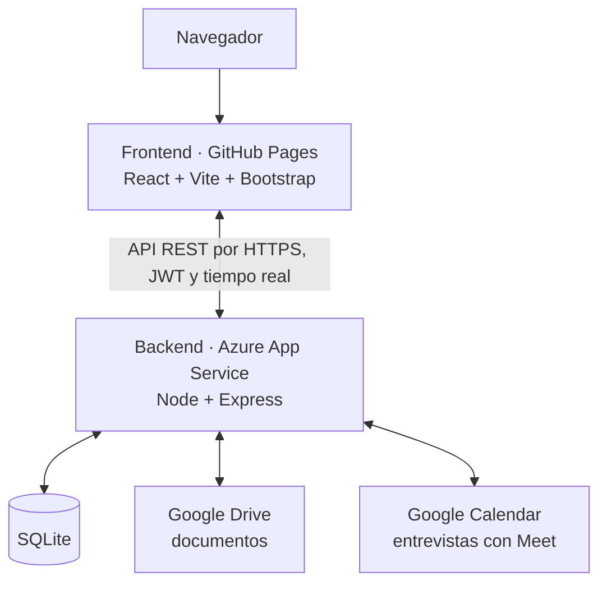

# AquaChile · Módulo de Evaluaciones Psicolaborales

MVP web del proyecto académico **DSY1104 – Desarrollo Full Stack II** (Duoc UC), en vinculación con el
área de Reclutamiento y Selección de **AquaChile**. Digitaliza el proceso desde que una persona postula a
una oferta hasta que se envía su informe psicolaboral.

> Es un prototipo académico, no un sistema productivo. **Todos los datos son ficticios.**

| | |
| --- | --- |
| **Aplicación** | <https://jesuscardenas-jacv1.github.io/Proyecto-AquaChile/> |
| **Portal de empleo** | <https://jesuscardenas-jacv1.github.io/Proyecto-AquaChile/trabaja-con-nosotros> |
| **API** | <https://aquachile-psicolaboral-api.azurewebsites.net/api> |

## Cómo funciona

1. **Postulante:** postula sin iniciar sesión en el portal **Trabaja con nosotros** y adjunta su CV.
2. **Analista:** revisa la bandeja **Postulaciones** y pasa a evaluación o descarta. Al pasar a evaluación,
   completa la solicitud, asigna la psicóloga y se crea la carpeta con el CV y el descriptor de cargo.
3. **Psicóloga:** gestiona la solicitud en su **Planner**: *Evaluación Recibida → Entrevista Agendada →
   Entrevista Realizada*. Luego registra la evaluación, con lo que se genera el informe PDF y la solicitud
   queda en *Informe enviado*.
4. **Jefatura:** consulta el dashboard y los listados en modo solo lectura.

Reglas importantes:

- El estado oficial avanza junto con las etapas: `Pendiente → En proceso → Finalizada`. **Solo se gestiona en
  el Planner**: el detalle de la solicitud lo muestra, y el backend rechaza cambios por fuera de ese flujo.
- Una solicitud se puede **cerrar sin evaluación**, por ejemplo si la persona desiste, y reabrir en la etapa
  en que estaba.
- **Reuniones online:** al agendar la entrevista, la psicóloga elige Teams, Google Meet, Presencial o Telefónica.
  Con **Google Meet** el backend crea el evento en Google Calendar, con su enlace de Meet; al reagendar lo
  actualiza y, al cerrar sin evaluación, puede cancelarlo. Con **Teams** la psicóloga pega el enlace de la
  reunión. La tarjeta del Planner y el detalle de la solicitud muestran **Unirse a la reunión**; la jefatura solo
  ve la modalidad. Si el calendario falla o no está autorizado, la entrevista se agenda igual y se muestra un aviso.
- **El descriptor se guarda por cargo:** se sube una vez y lo reutilizan sus ofertas y solicitudes. Cada
  solicitud guarda su propia copia, que cambia si se corrige el cargo.
- La **pauta de entrevista** y las notas clínicas son confidenciales: en la app solo las ven la psicóloga y
  el administrador.

### Ayudas de IA

Con una clave de Anthropic en el servidor (`ANTHROPIC_API_KEY`) aparecen estas ayudas; sin clave, no se muestran.
Para el analista:

- **Análisis del CV** en Postulaciones: compara el CV con los requisitos de la oferta (o, si no tiene, con los del
  descriptor del cargo), marca cada uno como cumple, parcial, sin evidencia o "confirmar en la entrevista" y muestra
  el **% de cumplimiento**, junto con datos a confirmar y preguntas para la entrevista. El porcentaje no lo inventa
  la IA: lo calcula el servidor con pesos fijos (obligatorio 2, deseable 1). Separa lo que el CV respalda, las **brechas para
  el cargo** y lo que hay que confirmar en la entrevista. La psicóloga ve el mismo análisis en el detalle de la solicitud.
  No recomienda contratar ni descartar.
- **Completar con IA desde el CV** en Nueva solicitud: llena nombre, correo y teléfono vacíos y deja el CV adjunto.
- **Redactar con IA** en ofertas: propone título, descripción y requisitos a partir del descriptor del cargo.

Para la psicóloga:

- **Borrador de la evaluación** en Registrar evaluación: a partir de sus notas de la entrevista, propone nivel,
  fortalezas y oportunidades por competencia, las observaciones y un resultado sugerido con su fundamento. El
  resultado no queda marcado: lo elige ella. Las notas no se guardan.
- **Entrevista con IA** en el detalle de la solicitud, con la entrevista agendada o realizada: tras marcar que el
  postulante aceptó la grabación (Ley 21.719), graba el micrófono (entrevista presencial) o el micrófono más el audio
  de la pestaña de Meet o Teams web, o recibe la transcripción exportada (`.vtt`, `.docx` o `.txt`). Transcribe con
  **Azure AI Speech** (español de Chile, o México / España si la región no lo admite, con separación de voces), guarda
  el texto como **pauta de entrevista** (confidencial, con quién confirmó el consentimiento y cuándo) y propone notas
  por competencia con citas breves. «Usar en el borrador» las lleva al borrador de la evaluación. **El audio no se
  guarda.** La grabación necesita `AZURE_SPEECH_KEY` y `AZURE_SPEECH_REGION`; sin ellas solo se ofrece subir la
  transcripción.

Todo es una sugerencia que el equipo revisa. Usa Claude Opus 5.5 con respuestas en un formato JSON fijo, y las
instrucciones le indican tratar el contenido de los documentos como datos, no como órdenes.

## Arquitectura



Es una aplicación monolítica, sin microservicios. El frontend tiene dos modos:

- **api:** hay backend. El inicio de sesión usa JWT y los datos se leen y guardan en la base de datos.
- **local:** sin backend. Usa datos de demostración guardados en `localStorage`, solo en ese navegador.

El pie de página indica el modo activo.

## Stack

| Parte | Lenguaje | Tecnologías |
| --- | --- | --- |
| **Frontend** | JavaScript (JSX) y CSS | React 18.3, Vite 5.4, Bootstrap 5.3, Bootstrap Icons 1.13, React Router 6.26, Mammoth 1.8 |
| **Backend** | JavaScript (Node 22) | Express 4.19, `jsonwebtoken` 9, `bcryptjs` 2.4, PDFKit 0.15, CORS, Mammoth |
| **IA** | — | SDK de Anthropic (`@anthropic-ai/sdk`), modelo Claude Opus 5.5; Azure AI Speech (transcripción rápida, nivel gratuito F0) |
| **Base de datos** | SQL | SQLite con el módulo nativo `node:sqlite` |
| **Documentos** | — | Disco local, Google Drive (producción) u OneDrive/SharePoint, según `backend/.env` |
| **Pruebas** | JavaScript | Vitest 2.1, Testing Library 16 y cobertura v8; `node:test` en el backend |

## Instalación y ejecución

Requiere Node 22 para el backend.

```bash
npm install && npm --prefix backend install
npm run backend:migrar && npm run backend:semilla   # crea y llena SQLite con los datos de demostración
npm run backend:dev                                 # API en http://localhost:3001
npm run dev                                         # app en http://localhost:5173
```

Sin backend, basta con `npm install` y `npm run dev`. Para apuntar a otro backend, construye con
`VITE_API_URL=https://.../api`.

El almacenamiento de documentos y las variables de entorno están explicados en
[`backend/README.md`](backend/README.md), junto con el catálogo de endpoints.

Otros comandos:

```bash
npm run build         # build de producción en dist/
npm run preview       # previsualiza el build
npm run importar:bd   # regenera los datos semilla desde el Excel de bd/
```

## Despliegue

| Parte | Cuándo se publica | Cómo |
| --- | --- | --- |
| **Frontend** | Automático al fusionar a `main` | `.github/workflows/pages.yml` ejecuta las pruebas, compila con Vite y publica en GitHub Pages |
| **Backend** | Manual | `backend/scripts/empaquetar-azure.sh` y `az webapp deploy`; ver [`backend/README.md`](backend/README.md) |

Si un cambio afecta a ambos, **despliega primero el backend y después fusiona**. Las migraciones se aplican
al iniciar el servidor.

## Vistas y permisos

El administrador también puede entrar a todas las rutas protegidas.

| Ruta | Vista | Acceso |
| --- | --- | --- |
| `/trabaja-con-nosotros` | Portal público con las ofertas | Sin sesión |
| `/trabaja-con-nosotros/ofertas/:id` | Oferta y formulario de postulación con CV | Sin sesión |
| `/login` | Inicio de sesión | Sin sesión |
| `/` | Dashboard con indicadores | Todos los roles |
| `/ofertas` | Lista y publicación de ofertas | Analista; jefatura solo lectura |
| `/ofertas/nueva`, `/ofertas/:id/editar` | Crear y editar ofertas | Analista |
| `/postulaciones` | Bandeja: pasar a evaluación o descartar | Analista; jefatura solo lectura |
| `/candidatos` | Directorio de candidatos | Todos; la psicóloga solo ve a quienes pasaron a evaluación |
| `/candidatos/:id` | Ficha con las carpetas de sus solicitudes | Todos los roles |
| `/candidatos/nuevo`, `/candidatos/:id/editar` | Registrar y editar candidatos | Analista |
| `/solicitudes` | Bandeja con búsqueda y filtros | Todos los roles |
| `/solicitudes/nueva` | Crear una solicitud | Analista |
| `/solicitudes/:id` | Ficha, seguimiento, documentos y evaluación | Todos; las notas clínicas son solo de la psicóloga |
| `/solicitudes/:id/informe` | Informe imprimible | Todos; sin notas clínicas para analista y jefatura |
| `/planner` | Gestión de las etapas de cada solicitud | Psicóloga; jefatura solo lectura |
| `/planner/informes` | Informes enviados | Psicóloga; jefatura solo lectura |
| `/administracion` | Usuarios de prueba, roles y datos de demostración | Administrador |

## Usuarios de demostración

| Rol | Correo / alias | Contraseña | Funciones |
| --- | --- | --- | --- |
| **Analista de Reclutamiento** | `carolina.munoz@aquachile.cl`<br>`analista@aquachile.cl` | `AquaChile2026!` | Gestiona ofertas y postulaciones, crea candidatos y solicitudes, asigna psicóloga y consulta el dictamen. |
| **Profesional Evaluador** | `ignacia.valdes@aquachile.cl`<br>`evaluador@aquachile.cl` | `AquaChile2026!` | Avanza las solicitudes en su Planner, registra notas clínicas y dictamen. |
| **Administrador académico** | `andres.valdivia@aquachile.cl`<br>`admin@aquachile.cl` | `AquaChile2026!` | Todo lo del analista y del evaluador; ve usuarios, roles y catálogos y restablece los datos de demostración. |
| **Jefatura / contraparte** | `patricia.saavedra@aquachile.cl`<br>`jefatura@aquachile.cl` | `AquaChile2026!` | Solo lectura: dashboard, listados, detalle y dictamen, sin notas clínicas. |

## Datos

Tablas principales de la base de datos:

| Tabla | Contenido |
| --- | --- |
| `candidatos` | Datos de contacto, origen y cargo |
| `solicitudes` | Cargo, familia, reclutador, psicóloga, estado, etapa, entrevista, cierre y descriptor |
| `evaluaciones` | Fecha, resultado, observaciones y competencias |
| `ofertas`, `postulaciones` | Portal público y bandeja del analista |
| `cargos` | Descriptor guardado por cargo |
| `notificaciones`, `fotos_usuario` | Avisos y foto de perfil |

Los catálogos principales son:

- **Estado de la solicitud:** `Pendiente`, `En proceso`, `Finalizada`.
- **Resultado de la evaluación:** `Recomendado`, `Recomendado con observaciones`, `No recomendado`.

### Datos de demostración

La fuente es `bd/BD_Simulada_Evaluaciones_Psicolaborales_AquaChile.xlsx`. El script
`scripts/importar-bd-simulada.mjs` la convierte en `src/datos/bdSimulada.json`, que no se edita a mano.
`src/datos/semillaBase.js` le agrega los casos del Planner y del portal, y el backend siembra SQLite con esos
mismos datos.

La semilla trae 116 candidatos, 108 solicitudes, 8 ofertas y 8 postulaciones, con 20 cargos en el catálogo.
Los descriptores ficticios de esos cargos están en `public/descriptores/`.

## Estructura del proyecto

```
src/
├── App.jsx            # rutas y permisos por rol
├── paginas/           # una vista por ruta
├── componentes/       # admin, candidatos, comunes, dashboard, evaluacion, layout,
│                      # ofertas, perfil, planner, portal, solicitudes
├── dominio/           # lógica pura: validaciones, consultas, indicadores, planner
├── datos/             # contextos de autenticación y datos, catálogos y semilla
├── servicios/         # cliente de la API, documentos y tiempo real
└── pruebas/           # configuración y utilidades de pruebas

backend/
├── src/
│   ├── servidor.js    # aplicación Express
│   ├── rutas/         # endpoints de la API
│   ├── middlewares/   # autenticación, roles, límites y errores
│   ├── bd/            # conexión, migraciones, semilla y formatos de respuesta
│   └── almacenamiento/ # proveedores de documentos e informe PDF
└── scripts/           # empaquetado para Azure y generación de descriptores
```

Cada componente o página nueva lleva su `*.test.jsx` al lado. Las convenciones del equipo están en
[`CLAUDE.md`](CLAUDE.md).

## Pruebas y cobertura

El docente dejó la herramienta a elección del equipo, y se usa **Vitest + Testing Library** como equivalente
moderno de Jasmine y Karma.

```bash
npm test                 # frontend
npm run test:watch       # frontend en modo watch
npm run test:coverage    # frontend con cobertura; el reporte queda en cobertura/index.html

npm --prefix backend test                        # prueba rápida de la API
npm --prefix backend run test:almacenamiento     # documentos
npm --prefix backend run test:auth               # clave de sesiones
npm --prefix backend run test:roles              # permisos de los 4 roles (requiere BD sembrada)
npm --prefix backend run test:integracion        # API usada por el frontend (requiere BD sembrada)
npm --prefix backend run test:ia                 # ayudas de IA con un cliente simulado (sin costo)
npm --prefix backend run test:reuniones          # Google Calendar y Teams con respuestas simuladas
```

Resultados a noviembre de 2026:

- **Frontend:** 563 pruebas en 71 archivos.
- **Backend:** 129 pruebas entre almacenamiento, autenticación, roles, integración, IA y reuniones.

| Cobertura del frontend (v8) | Actual | Mínimo |
| --- | --- | --- |
| Sentencias | 94,75 % | 80 % |
| Ramas | 88,09 % | 75 % |
| Funciones | 81,84 % | 80 % |
| Líneas | 94,75 % | 80 % |

`npm run test:coverage` falla si la cobertura baja de esos mínimos, definidos en `vite.config.js`.

## Fuera de alcance

Copilot, Power Automate y Microsoft Planner quedan como evolución futura, igual que la redacción del informe completo con IA y las transcripciones automáticas de Teams o Meet (requieren licencias y permisos de administrador; la app transcribe por su cuenta). El Planner de esta
app es propio. OneDrive/SharePoint está disponible como proveedor de documentos, pero producción usa Google Drive.
Crear la reunión de Teams automáticamente (Microsoft Graph) queda preparado pero desactivado: requiere que la TI de
AquaChile registre la aplicación en Entra ID (ver `backend/README.md`).
